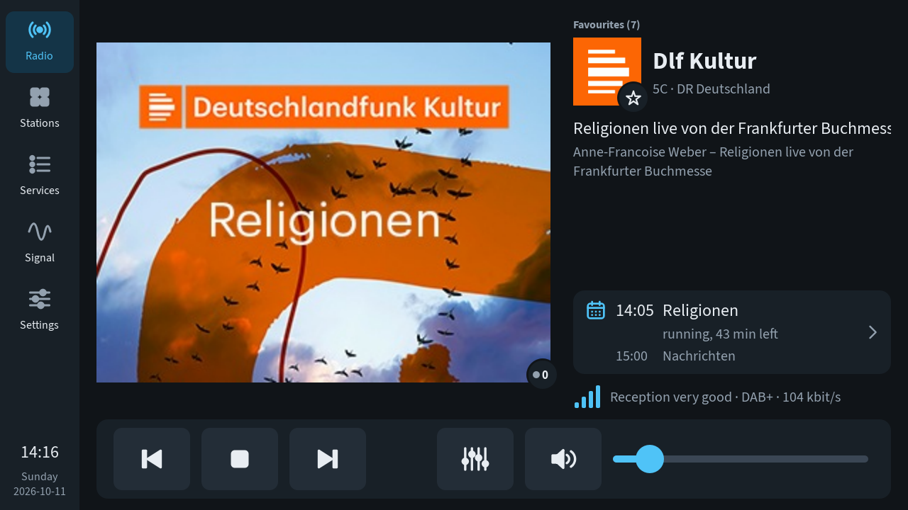
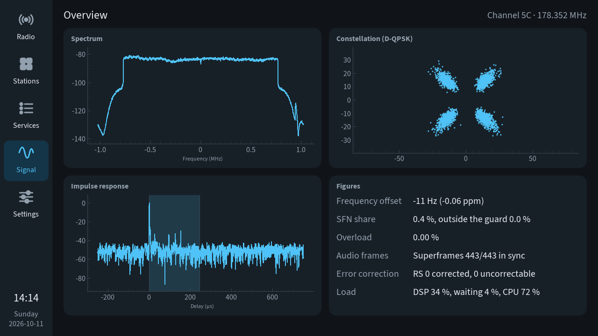
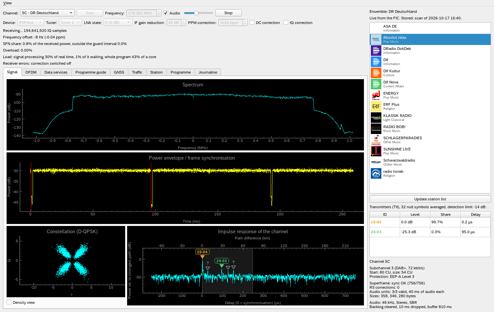
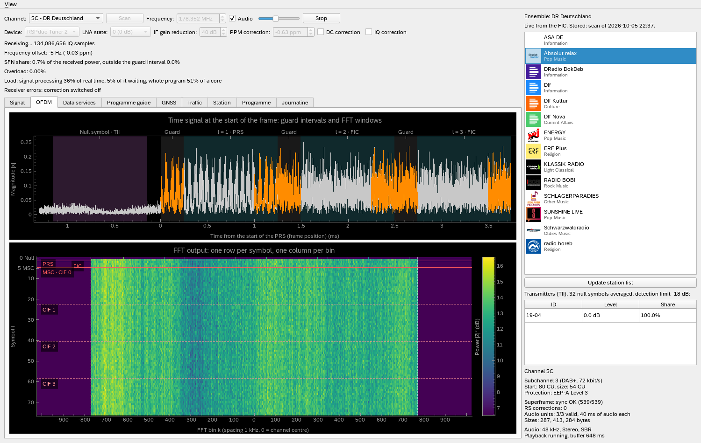

# DAB+ Radio

What started out as a project for learning about the modulation and encoding of a DAB+
signal has somehow escalated into a fairly full-featured DAB+ radio written in Python.

It takes the I/Q samples of an RTL-SDR stick, an SDRplay RSPduo or an rtl_tcp server and
decodes them itself, in NumPy and numba, from synchronisation and OFDM demodulation down to the error
correction. Since every step runs in Python, every step can be shown: spectrum, null
symbol search, constellation, the FFT of each symbol, the error correction.

Two user interfaces share one core:

- **Touch UI** for the Raspberry Pi with the Touch Display 2 (7"). It can be configured to
  start at boot and can be used as a normal radio.
- **Desktop window** for the PC. The desktop UI is a remnant from the project's early days
  and was primarily intended for signal analysis, not for use as a radio.

<p>
  
  
</p>

## Features

- **Reception:** Band III (channels 5A to 13F) with an RTL-SDR stick, one tuner of an
  SDRplay RSPduo, or a stick on another computer served by rtl_tcp. A scan reads the
  station lists of all channels and keeps them.
- **Decoding:** null symbol detection, frame timing, frequency offset correction, OFDM
  demodulation, D-QPSK, deinterleaving, Viterbi decoding (UEP and EEP), FIC and MSC,
  Reed-Solomon for DAB+, transmitter identification (TII) and SFN share.
- **Data services:** MOT slideshow, Dynamic Label with DL Plus, programme guide (SPI) with
  station logos, Journaline, announcements (also from other ensembles), traffic messages
  from ARD TPEG on a list and a map, and the GNSS corrections of GEPOS (RTCM 3, SSRZ) with
  a sky plot and a 3D view of the orbits.
- **Audio:** a five-band equalizer for all stations or per station, output to the sound
  card, a USB sound card or Bluetooth devices.
- **Recording** (Touch UI): the last titles played, split at the title changes and
  stored on a USB drive. Titles can be kept, and a cutter sets their start and end
  losslessly, also beyond the original file, for stations whose labels come late or not
  at all.
- **Remote control:** MQTT with Home Assistant discovery, including notifications with
  buttons on the display.
- **Themes** (Touch UI): a dark and a light theme.
- **Languages:** English and German.

## The Touch UI on the Raspberry Pi

### Hardware

| Part | Supported | Notes |
|---|---|---|
| Computer | Raspberry Pi 5, 64-bit Raspberry Pi OS Lite (Trixie) | Other models have not been tested. The Pi 5 handles the signal processing in real time. |
| Display | Raspberry Pi Touch Display 2 (7", 720 × 1280) | Used in landscape, on either DSI connector. |
| Receiver | RTL-SDR stick (RTL2832U with R820T/R820T2) | |
| Receiver | SDRplay RSPduo | One tuner at a time. Needs the SDRplay API 3.15 from sdrplay.com. |
| Receiver | An RTL-SDR stick on another computer, served by rtl_tcp (“RTL_TCP”) | Start it there with `rtl_tcp -a 0.0.0.0`. The samples take about 33 Mbit/s: a cable is safe, Wi-Fi needs a good connection. |
| Antenna | Any Band III antenna | Close to a transmitter, a telescopic antenna indoors is enough. |
| Audio | HDMI, a sound HAT, a USB sound card or Bluetooth headphones | Anything PipeWire provides. |
| Storage | A USB drive (FAT, exFAT, NTFS or ext4) | Only for recordings; the radio mounts it itself. |
| Network | The Pi's Wi-Fi and Bluetooth | Both are set up on the touch screen. |

The radio works wherever DAB is broadcast in Band III. The traffic and GNSS pages need
what German ensembles carry (ARD TPEG, GEPOS); elsewhere they stay empty.

### Installation

1. Install 64-bit Raspberry Pi OS Lite, connect the Pi to the network and log in.
2. Run the install script:

   ```sh
   curl -fsSL https://raw.githubusercontent.com/rtoenniges/dab-radio/HEAD/pi/install.sh | sudo sh
   ```

   Or clone the repository yourself; the script then installs the commit of your clone:

   ```sh
   git clone https://github.com/rtoenniges/dab-radio.git dab-radio
   sudo sh dab-radio/pi/install.sh
   ```

3. Reboot. The radio starts full screen. On the first start it opens the station page,
   where **Scan** finds the stations.

The script installs the system packages (the kiosk compositor cage, PipeWire, BlueZ,
NetworkManager, UDisks2, FAAD2, mpg123 and the libraries Qt needs), the udev and polkit
rules from `pi/`, Python 3.14 with the packages, and a systemd unit that starts the radio
on tty1 at boot. The radio is installed in `/opt/dab-radio` and runs under its own account
`dabradio` (no password, no login shell); its data is in
`/var/lib/dab-radio/.local/share/dab-radio`. Every step checks first and changes only what
differs, so the script can be run again at any time. The console shows one line per step;
everything else goes to `/var/log/dab-radio-install.log`.

Not covered by the script: the SDRplay API (only needed for the RSPduo) and the
[optional data files](#optional-data-for-the-traffic-pages).

| Option | Effect |
|---|---|
| `--update` | Fetches the newest commit of the branch first (when run from `/opt/dab-radio`). |
| `--dry-run` | Only reports what a run would change. Needs no root. |
| `--user NAME` | Runs the radio under an existing account instead of `dabradio`. |
| `--from URL` | Takes the code from another repository. |
| `--no-autostart` | Leaves out the systemd unit. |
| `--splash` | Adds a boot splash (Plymouth): the constellation locking in. |
| `--no-splash` | Removes the boot splash again. |
| `--verbose` | Shows all output on the console instead of writing the log. |

When the script is piped, the options follow `sh -s --`, for example
`curl -fsSL https://raw.githubusercontent.com/rtoenniges/dab-radio/HEAD/pi/install.sh | sh -s -- --dry-run`.

`--splash` and `--no-splash` are the only options that touch the kernel command line
(`/boot/firmware/cmdline.txt`). `--splash` adds `quiet splash plymouth.ignore-serial-consoles`
and replaces the `video=` entry of the display's DSI connector with one that sets the
panel orientation, because Plymouth ignores `rotate=`. The display must be connected
while the script runs. `--no-splash` removes the three entries and keeps the `video=`
entry. The original file is kept as `cmdline.txt.dab-radio.bak`.

**Updating:**

```sh
sudo sh /opt/dab-radio/pi/install.sh --update
```

With a clone of your own, run `git pull` and `sudo sh pi/install.sh` there. At the end
the script says whether a reboot or a restart of the radio is needed.

**Logs:** `journalctl -t dab-radio -f`

### Pages

A rail on the left leads to five pages:

| Page | Content |
|---|---|
| Radio | Slideshow, Dynamic Label, programme and Journaline of the station playing; volume, mute and equalizer. A long press on the slideshow puts a diagram in its place (spectrum, constellation, null symbol in 3D …), a long press on the loudspeaker chooses the output, and the badge on the slideshow leads to the recordings. |
| Stations | All known stations as tiles, filtered by favourites or ensemble. A long press marks a favourite; **Scan** reads all channels. |
| Services | Data services, programme guide, GNSS and traffic |
| Signal | Overview, synchronisation, OFDM, a 3D detail view of one captured second, single frequency network, error correction |
| Settings | SDR, display, audio, Wi-Fi, Bluetooth, storage, recording, MQTT |

The Touch UI also runs in a 1280 × 720 window on a PC:
`uv run python src/main.py --touch`.

### Troubleshooting

| Problem | Solution |
|---|---|
| No touch input after booting | The touch controller sometimes fails to respond at boot, mostly after a warm start. The unit rebinds the driver (`pi/rebind-touch.sh`); if the touch stays dead, unplug the power instead of rebooting. |
| Dimming the screen has no effect | The udev rule for the backlight is missing. Run the install script again. |
| Bluetooth headphones connect but stay silent | PipeWire's Bluetooth plugin or the WirePlumber settings are missing. Run the install script again. |
| Bluetooth headphones sound tinny | Another device holds the Pi's only A2DP stream, so they fall back to the hands-free profile. Choose them under Settings › Audio › Output. |
| The RSPduo is not found | The SDRplay API service must be running, and only API 3.15 is accepted. |
| The rtl_tcp server refuses the connection | rtl_tcp listens only on its own computer unless started with `-a 0.0.0.0` (or its address). |
| The rtl_tcp server sends nothing | rtl_tcp serves one program at a time; another one is connected to it. |
| Audio drops out with RTL_TCP over Wi-Fi | The radio holds one second of audio; TCP over Wi-Fi pauses for longer when packets are lost (seen while a window was dragged on the PC). A cable to the Pi is safer. |
| Audio drops out with RTL_TCP while the computer is busy (Linux) | Linux limits the receive buffer the radio may ask for; allow 16 MiB with `sudo sysctl -w net.core.rmem_max=16777216` (lasting in a file under `/etc/sysctl.d/`). |

## The desktop window

<p>
  
  
</p>

### Installation on a PC

[uv](https://docs.astral.sh/uv/) downloads Python 3.14 and the packages:

```sh
git clone https://github.com/rtoenniges/dab-radio.git
cd dab-radio
uv sync
uv run python src/main.py
```

The audio decoders and receivers need some system components:

| | Windows | Linux |
|---|---|---|
| Audio decoders | `pwsh native\build_codecs.ps1` builds `faad.dll` and `mpg123.dll` into `native\` (see below); DLLs from elsewhere (`libfaad-2.dll` from MSYS2, `libmpg123-0.dll` from mpg123.de) go into `native\` or `.venv\Scripts` | `apt install libfaad2 libmpg123-0` |
| RTL-SDR | WinUSB driver, installed with Zadig | udev rule from the `rtl-sdr` package |
| RSPduo | SDRplay API 3.15, with its service running | SDRplay API 3.15, with its service running |
| rtl_tcp | Nothing here; rtl_tcp (part of rtl-sdr) on the computer with the stick | The same |

Without the decoders the radio runs, but stays silent and says why. The desktop window
has only been tested on Windows so far; the Pi runs the same code.

On Windows, `pwsh native\build_codecs.ps1` builds the two audio decoders from their
original, unchanged sources: FAAD2 2.11.4 from the project's git repository and
libmpg123 1.33.7 from the release tarball of mpg123.de, both pinned, with CMake and
the static C runtime, so that the DLLs depend on nothing but Windows (needs git and
Visual Studio with the C++ tools and its CMake component). `pwsh native\build_rtlsdr.ps1`
optionally builds a custom `rtlsdr.dll` (git and the C++ tools suffice). It enables
RAW_IO, so that no samples are lost between USB transfers, and restores the IF AGC of
the tuner.

### Using the desktop window

The rows at the top set the device, gain, channel and volume, and start the reception or
a scan; the status lines below report frequency offset, SFN share, overload and load. The
list on the right shows the stations of the ensemble, the transmitters found by TII and
details of the station playing. A click plays a station.

| Tab | Shows |
|---|---|
| Signal | Spectrum, power envelope with the null symbols, constellation, channel impulse response |
| OFDM | Time signal with guard intervals and FFT windows; FFT output of all symbols |
| Data services | The data services in packet mode, and for one of them the path from Reed-Solomon to the MOT carousel |
| Programme guide | The programme guides (SPI) of all channels |
| GNSS | GEPOS: sky plot and orbits, ionosphere and troposphere maps, corrections at the listener's position, NTRIP caster |
| Traffic | ARD TPEG: messages on a list and a map, traffic flow, the bytes of a message |
| Station | Announcements, bits before and after the error correction, superframe layout, audio level |
| Programme | Dynamic Label with DL Plus, MOT slideshow |
| Journaline | The text pages of the station |

The language is set under **View › Language** and takes effect after a restart.

## Optional data for the traffic pages

Two data files are built on a PC and are not part of the repository:

| File | Used for | Created with |
|---|---|---|
| `road_network.npz` (about 17 MB) | Roads on the traffic map | `uv run python tools/build_road_network.py` (downloads the OpenStreetMap extract of Germany, about 5 GB) |
| `tmc_locations.npz` (about 1 MB) | Road and place names in traffic messages | `uv run python tools/import_tmc_locations.py <download>` (the location table published by each country's authority, in Germany the BASt) |

They belong in the data directory of the account that runs the radio (`<home>` is that
account's home directory):

| System | Data directory |
|---|---|
| Windows | `%APPDATA%\dab-radio` |
| Linux | `<home>/.local/share/dab-radio` |
| Raspberry Pi | `/var/lib/dab-radio/.local/share/dab-radio` (account `dabradio`) |

On the Pi the files must belong to the radio's account:

```sh
sudo install -o dabradio -g dabradio -m 644 road_network.npz tmc_locations.npz \
    /var/lib/dab-radio/.local/share/dab-radio/
```

If the radio runs under another account (`--user NAME`), use that account and
`<home>/.local/share/dab-radio` instead.

## Remote control over MQTT

The radio connects to the MQTT broker of a smart home (Mosquitto, Home Assistant,
openHAB, ioBroker …). It publishes its state and the slideshow, takes commands (station,
volume, output, equalizer, recording and more) and shows notifications with buttons on
the display. With MQTT discovery the entities appear in Home Assistant automatically.
MQTT is set up on the Touch UI under Settings › MQTT; the desktop window has no MQTT.
The interface is described in [docs/mqtt.md](docs/mqtt.md).

## Development

```sh
uv run pytest                               # tests
uvx ruff check .                            # lint
uvx ruff format .                           # format
uv run python src/i18n/update_catalogs.py   # after changing texts marked for translation
```

| Directory | Content |
|---|---|
| `src/dsp/` | Signal processing |
| `src/dab/` | FIGs, PAD, MOT, programme guide, Journaline, TPEG, RTCM, SSRZ, orbits, atmosphere |
| `src/sdr/` | RTL-SDR (pyrtlsdr), RSPduo (SDRplay API), rtl_tcp, scan |
| `src/audio/` | Decoding, playback, outputs, equalizer |
| `src/recording/`, `src/storage/` | Recording and USB drives |
| `src/net/` | MQTT, NTRIP, Bluetooth, Wi-Fi, D-Bus |
| `src/ui/` | The controller without widgets, the desktop window and `ui/touch/` |
| `src/i18n/` | Translation catalogs |
| `pi/` | What is installed on the Raspberry Pi |
| `native/` | Builds of the audio decoders and of `rtlsdr.dll` |
| `tools/` | Builders of the data files and the boot splash |

Further documents: the evaluated FIGs in [docs/fig-overview.md](docs/fig-overview.md),
the signal chain as a diagram in [docs/signal-chain/signal-chain.html](docs/signal-chain/signal-chain.html)
(open it in a browser) and the MQTT interface in [docs/mqtt.md](docs/mqtt.md).

## License

This program is free software: you can redistribute it and/or modify it under the terms
of the GNU General Public License as published by the Free Software Foundation, either
version 3 of the License, or (at your option) any later version. See [LICENSE](LICENSE).

[THIRD-PARTY.md](THIRD-PARTY.md) lists everything in the repository or used at run time
that comes from others, and under which terms: the font Source Sans 3 (SIL OFL), the
coastlines from Natural Earth, the coefficients of the Global Mapping Function
(Böhm et al. 2006), a table from welle.io, the patches to rtl-sdr and the libraries
loaded at run time. The SDRplay API is proprietary, optional and not part of the
repository; users install it themselves.
